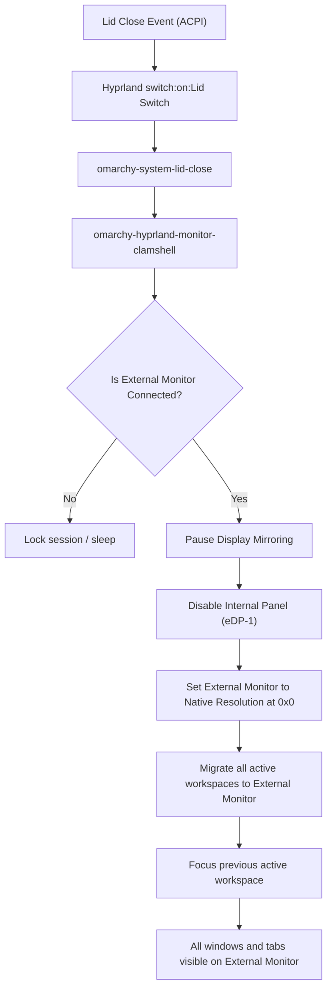

# omarchy-smart-clamshell

[](https://opensource.org/licenses/MIT)
[](https://omarchy.org)
[](https://hyprland.org)

**Smart, seamless clamshell mode with dynamic display mirroring and automatic workspace migration for Omarchy and Hyprland.**

---

## 🔍 The Problem

When using a laptop connected to an external monitor on **Omarchy / Hyprland**, closing the laptop lid often leads to a frustrating experience:

1. **The Mirroring Conflict**: If display mirroring is enabled, closing the lid causes the internal screen (`eDP-1`) to turn off. Because the external monitor is instructed to mirror the turned-off screen, Hyprland is left with **no active outputs**, resulting in a completely blank screen (`There are no outputs - creating placeholder screen`).
2. **Stranded Workspaces**: Even when the external monitor stays awake, open workspaces and windows remain locked to the now-disabled internal screen. The external monitor displays an empty desktop, and clicking workspace numbers on the status bar does nothing.

---

## ✨ The Solution: `omarchy-smart-clamshell`

`omarchy-smart-clamshell` provides intelligent, automated display lifecycle management:

* **Automated Clamshell Mode**:
  * **When you close the lid**: Display mirroring is automatically paused. The external monitor seamlessly becomes the primary standalone display at its full native resolution (e.g. 1440p / 4K).
  * **Workspace Migration**: All active workspaces, windows, and browser tabs are immediately migrated to the external monitor. Workspace buttons on your status bar remain fully responsive and clickable.
  * **When you open the lid**: Workspaces return to their original placement and display mirroring cleanly resumes.
* **Persistent Display Mode Switcher (`display-mode`)**:
  * Switch between **Mirror** (duplicate screens) and **Extended** (independent multi-monitor) mode anytime.
  * Your preference is remembered across system restarts.
* **Zero System File Tampering**: Everything installs cleanly in user space (`~/.local/bin/` and `~/.config/`), respecting Omarchy's upgrade path.

---

## 🚀 Quick Install

Clone and run the installer:

```bash
git clone https://github.com/avi-nash-kr/omarchy-smart-clamshell.git
cd omarchy-smart-clamshell
./install.sh
```

Or install directly via curl:

```bash
curl -fsSL https://raw.githubusercontent.com/avi-nash-kr/omarchy-smart-clamshell/main/install.sh | bash
```

---

## 🎮 Usage

You can change or check display modes anytime using the included `display-mode` CLI or keyboard shortcuts:

### CLI Commands

```bash
# Check current display mode and saved setting
display-mode status

# Switch to Mirror mode (duplicates when open; standalone when closed)
display-mode mirror

# Switch to Extended mode (dual screens when open; standalone when closed)
display-mode extended

# Toggle between Mirror and Extended modes
display-mode toggle
```

### Keyboard Shortcut

Press **`Super + Ctrl + Alt + Delete`** at any time to toggle between **Mirror** and **Extended** display modes on the fly.

### Display Scale

The external-monitor toggle file this project writes **does not pin a scale**.
Files in `~/.local/state/omarchy/toggles/hypr/` load *after*
`~/.config/hypr/monitors.lua`, so a hardcoded `scale = 1` there would silently
override whatever you picked from the **`Super + Ctrl + D`** monitor panel or with
`omarchy hyprland monitor scaling`. Scale is left to your `monitors.lua` rule, so
panel, CLI, and manual edits keep working in clamshell mode and across reloads.

---

## 🏗️ Architecture



---

## 📂 Project Structure

```
omarchy-smart-clamshell/
├── bin/
│   ├── display-mode                       # CLI profile switcher
│   ├── omarchy-hyprland-monitor-clamshell  # Clamshell & migration engine
│   └── omarchy-system-lid-close           # Lid-close dispatcher wrapper
├── config/
│   └── bindings.lua.sample                # Sample Hyprland configuration
├── hooks/
│   └── display-mode-sync.sh               # Post-boot desktop sync hook
├── install.sh                             # Automated installer
├── uninstall.sh                           # Clean uninstaller
├── LICENSE                                # MIT License
└── README.md
```

---

## 🗑️ Uninstallation

To completely remove `omarchy-smart-clamshell` and revert your Hyprland bindings to defaults:

```bash
cd omarchy-smart-clamshell
./uninstall.sh
```

---

## 📄 License

This project is licensed under the [MIT License](LICENSE).
Feel free to use, modify, and distribute it!
